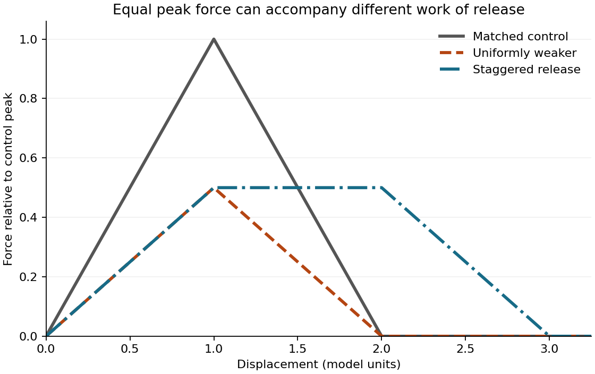

# Can two extraction mechanisms produce the same 50% reduction in peak force?

## The proposed experiment

The motivating target is a **50% average reduction in peak force relative to a matched vehicle control**. A lower peak can arise if each attachment carries less load or if attachment groups reach their peak at different displacements. This model makes those explanations compete. It predicts that a synthetic socket whose connectors release in stages can reach the same peak as a uniformly weaker socket while taking more displacement and more total work to release. Force, displacement and work are independently measurable. The idea is a hypothesis about dental test materials, with no asserted priority or clinical efficacy.

## Where the patent trail leads

| Record | What it establishes |
| --- | --- |
| [US10016492B2, granted 2018](https://patents.google.com/patent/US10016492B2/en#claims) | The earlier patent claims extraction methods involving collagenase and mechanical removal. Claim 1 specifies timing and the direction of extraction force. The grant concerns a procedure. |
| [2022 ColG paper](https://pmc.ncbi.nlm.nih.gov/articles/PMC9225053/) | A recombinant truncated ColG was compared with vehicle using matched porcine premolar roots outside the body. Mean force was about 20% lower. A few pairs approached 50% reduction. This is the vehicle-controlled performance benchmark. |
| [WO2023112020A1, published June 22, 2023](https://patents.google.com/patent/WO2023112020A1/en) | Ramot at Tel Aviv University filed PCT/IL2022/051304 on December 11, 2022. It describes modified recombinant collagenases and dental uses. The specification mentions 50% reductions. Its worked extraction example describes 50% for particular root pairs. |
| [2023 engineered-variant paper](https://pmc.ncbi.nlm.nih.gov/articles/PMC10353231/) | The team identified the PCT filing in its competing-interests statement and reported a nearly 4 °C rise in melting temperature. In the excised pig-jaw setup its engineered protein reduced mean force a further 11% relative to its parent. Effects across four root positions were 12%, 13%, 8% and 6%. |
| [US20240344047A1, published October 17, 2024](https://patents.google.com/patent/US20240344047A1/en#claims) | US application 18/676,485 is the US publication associated with the later family. Published claim 30 describes amino-acid replacements together with increased thermal stability relative to wild type, claim 36 a composition, and claims 37–38 dental use including extraction. A published claim can change during examination. |

The two extraction papers come from the same group, use different comparators and do not measure the effect of a new protein on impacted adult human wisdom teeth. The filings and articles are overlapping evidence. There is no empirical basis here to map a change in bond order, a docking score or a change in melting temperature to a 50% mean reduction in extraction force. No freedom-to-operate conclusion or assertion of a new collagenase structure follows from this search.

## What was simulated

Two groups of synthetic connectors share an external load. Each group contributes a triangular force pulse as displacement increases. Its force rises from zero to one and falls back to zero over two displacement units. This simple force law is a modeling choice. The groups can carry different fractions of the initial load and can engage at different displacements. A delay of one unit means that one group starts taking load when the first reaches its peak. All quantities are dimensionless.

We ran the model in [release_model.py](release_model.py). It sums the two force curves, finds the peak at their corners, and integrates total work exactly by trapezoids. Run it with `python3 release_model.py` from the repository directory.

| Case | Peak force relative to control | Work relative to control | Displacement to full release |
| --- | ---: | ---: | ---: |
| Matched control, both groups engage together | 1.00 | 1.00 | 2.0 |
| Both groups carry half the load, same onset | 0.50 | 0.50 | 2.0 |
| Equal shares, half-unit delay | 0.75 | 1.00 | 2.5 |
| Equal shares, one-unit delay | 0.50 | 1.00 | 3.0 |
| 70/30 shares, one-unit delay | 0.70 | 1.00 | 3.0 |

**Sensitivity result.** We varied the first group's load share in one-percentage-point steps from 30% to 70%, holding the one-unit delay fixed. Across the 41 equally weighted synthetic cases the mean peak reduction was **39.76%**, with a range of **30–50%**. This grid is a stress test of an assumption. A biological population would require independently measured input distributions. Conservation of work follows mathematically from shifting additive pulses of fixed area. The empirical hypothesis is whether a real material displays that pattern.

## A material to test the prediction

A candidate for an acellular dental teaching model is a removable synthetic socket insert with two populations of polymer connectors of different slack lengths. One possible junction chemistry is the reversible association of **β-cyclodextrin and adamantane**. Published materials work demonstrates host–guest junctions between polymer components. The molecular interaction is established prior art. The proposed design question is whether two connector lengths in a synthetic socket generate a reproducible low peak while retaining the area under the force curve. The code does not simulate that chemistry or establish that it works. [Primary materials study](https://pmc.ncbi.nlm.nih.gov/articles/PMC6403914/)

**Prediction and falsification.** Under matched geometry and pulling speed, compare inserts with equal connector lengths and inserts with two lengths. Retain the same junction chemistry and total number of connectors. Record full force–displacement curves, the area under the curves and displacement to full release. For the ideal equal-share, one-unit-delay case, the model predicts half the peak, unchanged work and 50% more travel. A repeatable fall in work alongside a lower peak would challenge staggered release as the sole mechanism. Junctions might rebind, share load unevenly, or fail to separate into two distinct populations. Keep those as competing explanations. No material specimen was made or tested.

## Bridging to the dental question

- Use the published 2022 paired force–displacement traces as context. They are representative curves, with cable slack, possible post-release soft-tissue forces and contact artifacts. Any later comparison of work needs independent rules for choosing the onset and endpoint, and complete curves across specimens. [Figure 2 and accompanying text](https://pmc.ncbi.nlm.nih.gov/articles/PMC9225053/figure/jfb-13-00076-f002/)
- Root geometry and pulling rate can change the force signal. In a clinical study of 59 routine root extractions, recorded maxima ranged from 41 to 629 N. A separate study of 49 swine incisor specimens linked load rate and root attachment area to peak force and tested finite-element predictions against measurements. These studies support specifying geometry and loading conditions. [Human study](https://doi.org/10.1016/j.jmbbm.2020.103711) · [Swine biomechanics](https://pmc.ncbi.nlm.nih.gov/articles/PMC11745890/)
- Recruitment and failure distributions already appear in models of fibrous tissue. The contribution to test is the distinguishing peak/work/travel prediction under a specified synthetic socket comparison. [Tendon model](https://pubmed.ncbi.nlm.nih.gov/34311323/)
- A future test of any candidate's 50% **mean** should declare the comparator, keep matched loading and geometry, and use whole held-out jaws as independent evaluation units. Define the outcome as mean within-jaw fractional peak reduction, with the root positions weighted consistently. Report jaw-to-jaw spread and an uncertainty interval, plus fractures or failed extractions. Peak force alone cannot establish tissue preservation or a molecule's activity in humans.
